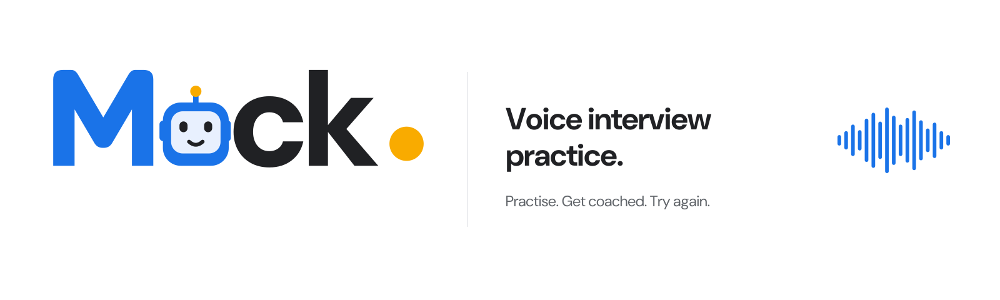
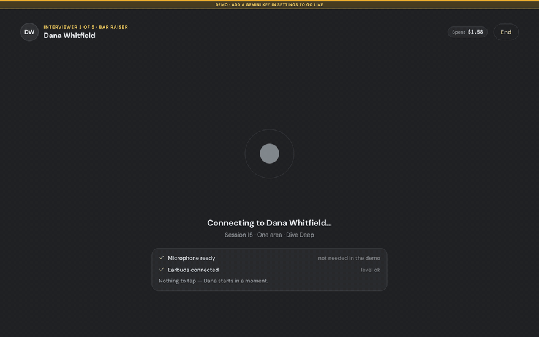
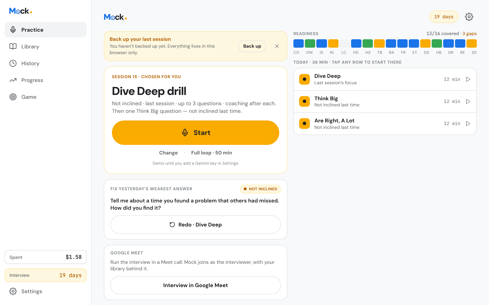
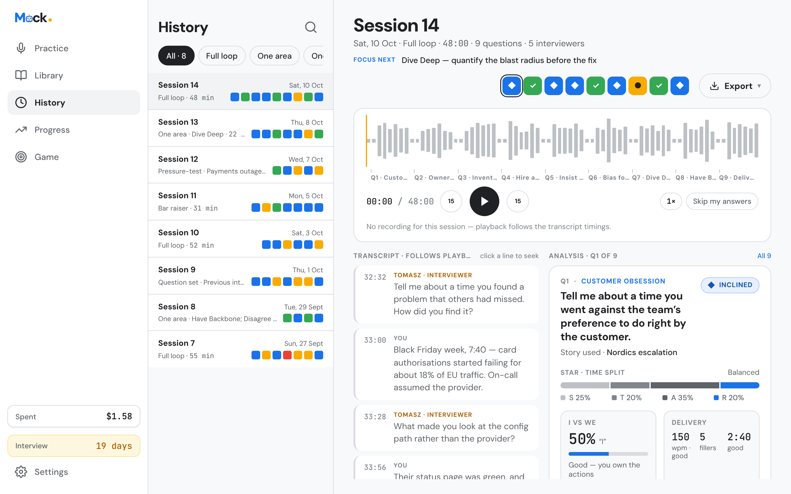
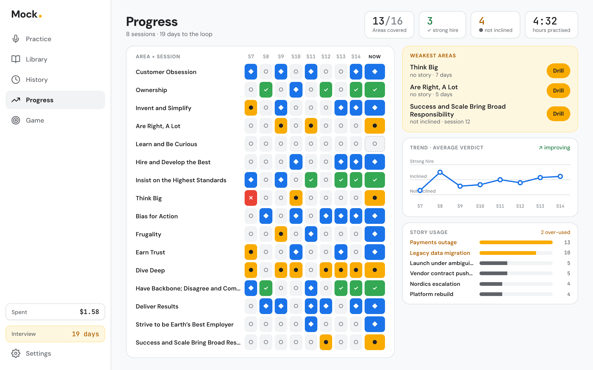
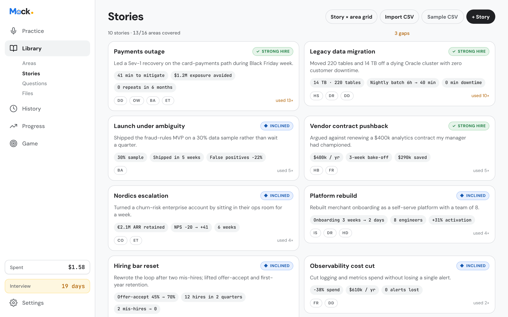

<picture>
  <source media="(prefers-color-scheme: dark)" srcset=".github/assets/mock-banner-dark.png">
  
</picture>

<p align="center">
  <b>Rehearse the interview out loud.</b><br>
  A live voice interviewer asks the questions and follows up. Between answers, a coach tells you
  what to fix, judged against your own stories and numbers.
</p>

<p align="center">
  <a href="https://github.com/adeelahmad/Mock/releases/latest"></a>
  <a href="LICENSE"></a>
  
  
  <a href="https://adeelahmad.github.io/Mock/"></a>
</p>

<p align="center">
  <a href="https://adeelahmad.github.io/Mock/app/"><b>Try the demo</b></a> ·
  <a href="https://adeelahmad.github.io/Mock/guide/getting-started">Get started</a> ·
  <a href="#install">Install</a> ·
  <a href="https://adeelahmad.github.io/Mock/">Docs</a>
</p>

<p align="center">
  
</p>

```console
curl -fsSL https://raw.githubusercontent.com/adeelahmad/Mock/main/install.sh | sh && mock
```

That's the whole app, the sign-in and sync server, and the Google Meet bridge in one binary.
Open http://localhost:8787. No Gemini key yet? Everything runs on the built-in demo.

## Why Mock

Reading your notes is not rehearsing. Interviews are spoken, timed and interrupted, and the
feedback you need is specific: *you said "significant" when your notes say $1.2M.*

- **A live interviewer.** Gemini Live asks questions on the areas the loop assesses
  (competencies, values, a company's principles), probes with follow-ups, and hears you out.
  Hands-free: say "redo", "next" or "hint".
- **A coach that knows your prep.** After each answer: a short spoken verdict and up to three
  fixes, checked against your own stories, numbers and notes. The numbers you missed, your STAR
  time split, "I" vs "we", pace and fillers.
- **Progress across sessions.** Every session is recorded, every answer gets an analysis card,
  every session a report. Weak areas come back until they aren't weak.
- **Your areas, your library.** Import areas, stories and questions from CSV, or load the
  built-in AWS Leadership Principles set to start.
- **Local-first.** Everything lives in your browser and works offline. Your Gemini key stays
  on your device and goes only to Google.
- **Sync with a passphrase, no account.** Your devices sync directly over WebRTC, end-to-end
  encrypted, even from GitHub Pages. Pair a phone with a short code or a QR code.
- **Interview in a real Google Meet call**, with a friend sitting in as a second interviewer.
- **Know what it costs.** Every token is counted and priced, per area.

<table>
  <tr>
    <td width="50%">
      <picture>
        <source media="(prefers-color-scheme: dark)" srcset="docs/media/practice-dark.png">
        
      </picture>
      <p align="center"><sub>Practice: today's drill, picked from your weakest areas</sub></p>
    </td>
    <td width="50%">
      <picture>
        <source media="(prefers-color-scheme: dark)" srcset="docs/media/session-dark.png">
        
      </picture>
      <p align="center"><sub>History: a report per session, a card per answer</sub></p>
    </td>
  </tr>
  <tr>
    <td width="50%">
      <picture>
        <source media="(prefers-color-scheme: dark)" srcset="docs/media/progress-dark.png">
        
      </picture>
      <p align="center"><sub>Progress: every area, across every session</sub></p>
    </td>
    <td width="50%">
      <picture>
        <source media="(prefers-color-scheme: dark)" srcset="docs/media/library-dark.png">
        
      </picture>
      <p align="center"><sub>Library: your stories, with the numbers that matter</sub></p>
    </td>
  </tr>
</table>

## Install

**One binary** (Linux and macOS, amd64 and arm64):

```console
curl -fsSL https://raw.githubusercontent.com/adeelahmad/Mock/main/install.sh | sh
mock              # the app + sign-in + sync on http://localhost:8787
mock --meet       # … and the Google Meet bridge
```

Or download a binary from [Releases](https://github.com/adeelahmad/Mock/releases/latest).
`MOCK_VERSION=v0.1.0` pins a release; `MOCK_INSTALL_DIR` picks where it goes.

Nothing else to install: no Node, no Go. **No install at all:** open the
[hosted app](https://adeelahmad.github.io/Mock/app/) and add it to your home screen.
**Proxmox:** a prebuilt LXC template, see [Deploy](#deploy).

**Build from source** (contributors only): needs Node 22 and Go 1.26+, then `make binary`.
See [Build from source](#build-from-source).

## How it works

```
 you ──voice──▶  Gemini Live interviewer  ──question / follow-up──▶ you
                        │ tools: your stories, numbers, notes (RAG over your prep files)
                        ▼
                 coach (spoken)  ──▶  analysis card (Gemini Flash)  ──▶  session report
                        │
 browser: DuckDB-Wasm on IndexedDB · recordings · offline PWA
 optional:  mock binary ── OAuth/OIDC sign-in · sync (SQLite/Postgres) · Meet bridge (Chromium)
```

## What it doesn't do

- It doesn't invent your experience. The coach works from the stories and numbers you give it.
- It isn't a hosted service. There's no account to create with us and no server of ours; the
  only calls leave your browser for Google's Gemini API, with your key.
- It doesn't run offline with a live interviewer: live sessions need a connection (the demo
  doesn't).
- No Windows binary yet; the hosted app works in any modern browser.

## Status

Young and moving fast. Every milestone in [`docs/plan.md`](docs/plan.md) has landed: the live
interviewer and coach, recordings, analysis and reports, the installable PWA, sync, and Google
Meet. Expect rough edges; [issues](https://github.com/adeelahmad/Mock/issues) and
[ideas](https://github.com/adeelahmad/Mock/discussions) are welcome.

## About this repo

User docs: the site in `site/` (`make docs`), published with the app on GitHub Pages.
Built to the Claude Design project in `design/` (the design is the spec). See `docs/plan.md`
for the architecture and milestones, `docs/design-inventory.md` for the feature checklist, and
`docs/STATUS.md` for where the work stands. Areas, stories and questions import from CSV; each
import offers a sample CSV to download and fill in (`src/domain/csv-templates.ts`).

## Use it

1. Open the deployed site (or run it locally, below).
2. First run: drop your prep files (stories, question lists), paste a Gemini API key, say hello.
   Without a key everything runs on the built-in demo transport.
3. **Install it.** iPhone/iPad: Safari → Share → *Add to Home Screen* (this also stops Safari
   clearing the data of a site you haven't opened in a while). Android, desktop Chrome or Edge:
   the *Install* notice on Practice, or the install icon in the address bar.
4. Back up after sessions (Settings → Library & data). Practice reminds you when the last
   session isn't in a backup yet.

### What it costs

Every Gemini call reports how many tokens it used, and Mock adds them up. The **Spent** pill
always shows the total: top-right on phone, in the sidebar on desktop, and in the header during
a live session. Tap it for the split per area. Live tokens count toward the area
of the question being asked, analysis cards toward the answer's area, and session reports and
question tagging go under "Reports & other".

The price is set in **Settings → Budget**: one row per model, in USD per 1M tokens, with text
and audio input/output priced separately. It comes filled with Google's published prices
(checked 2026-10-11; Gemini 3.8 Flash doubles on 2027-01-01). Mock stores the token counts, not
dollars, so a new price re-prices everything already spent. Models without a row use the first
row. *Reset spend* sets the counter back to $0. The counts live in settings, so backups carry
them.

### Shortcuts and deep links

The installed app has two shortcuts (long-press the icon on Android, right-click on desktop):

| Link | Does |
|---|---|
| `…/#/start` | starts today's suggested drill |
| `…/#/last` | opens the latest session in History |

On iPhone, an iOS Shortcut ("Open URL" with either link) can go on the Action button or a
widget; a PWA can't add lock-screen widgets itself.

### Offline

Once loaded, the app shell, library, History and Progress work offline (service worker).
Live sessions need a connection: Practice says so and disables Start. The demo runs offline.

### Google Meet

Mock can run the interview inside a Google Meet call: it joins as a participant, asks the
questions out loud, hears everyone in the call (a friend can sit in as a second interviewer),
and coaches as usual. The session still runs in the app, with your library, tools, cards and
History; the call is only where the audio goes. See `docs/meet.md`.

1. On the same computer: `mock bridge` (or `make bridge`; add `--headed` to watch the bot's
   browser, `--profile DIR` for a signed-in bot profile). It needs Chrome or Chromium installed
   (found on `PATH`, or `MOCK_BRIDGE_CHROMIUM=/path/to/chrome`) and prints a pairing code.
   Running the app from the binary on your own computer? `mock --meet` serves the bridge too.
2. Practice → **Interview in Google Meet** → enter the code → paste a Meet link, or sign in with
   Google to create one (needs an OAuth client id: `VITE_GOOGLE_CLIENT_ID` at build time or typed
   in the sheet, with the Meet REST API enabled and the app's origin allowed).
3. **Invite Mock**, let it in if Meet asks, then **Start drill in Meet**. Needs a Gemini key.

The bridge only listens on 127.0.0.1, only accepts the app's origins (`MOCK_BRIDGE_ORIGINS` to
change), and only after the pairing code. The Gemini key never leaves the app.

## One binary

`mock` is the whole app in one self-contained file: the built web app is embedded, and the same
binary is the sign-in and sync server and the Google Meet bridge. It is pure Go (SQLite
included), so it needs nothing else to run; only the Meet bot needs a Chrome or Chromium beside
it. Get it with the [install script](#install) or from
[Releases](https://github.com/adeelahmad/Mock/releases/latest).

```
mock                   # the app + sign-in + sync on http://localhost:8787
mock --meet            # … and the Meet bridge (ws://127.0.0.1:8788 and the main port)
mock token             # the setup token the sign-in wizard asks for
mock bridge            # only the Meet bridge, for the app hosted elsewhere (GitHub Pages)
mock help
```

Copy it anywhere and run it; data goes to `data/mock.db` next to where it runs (`MOCK_DB` to
move it). Put HTTPS in front of it for anything but localhost: the microphone and service
worker need a secure origin.

## Build from source

For contributors; running Mock needs none of this. Building needs Node 22.18+ and Go 1.26+.
`make binary` builds `bin/mock` for this machine, `make binaries` cross-compiles
`bin/mock-{linux,darwin}-{amd64,arm64}`.

With `make` (run `make help` for the list):

```
make install           # npm install, devDependencies included
make dev               # http://localhost:5173 (PORT=… to change)
make check             # typecheck + unit tests + build, then Go vet + tests
make e2e               # Playwright; the production build runs from bin/mock (PW_CHROMIUM=/path/to/chromium)
make verify            # check, then e2e
make preview           # build, then serve dist/ with Vite
make server            # the Go server's API on :8787 (sign-in + sync); `make dev` proxies to it
make serve             # build bin/mock, then serve app + API from it
make bridge            # only the Meet bridge on 127.0.0.1:8788
make token             # print the sign-in setup token
make binary            # bin/mock (see One binary)
make docs              # the docs site on :5174
make docs-build        # docs + app at /app/ into site/.vitepress/dist
make clean             # remove dist/, bin/ and test results
```

Or the npm scripts directly:

```
npm install            # add --include=dev if NODE_ENV=production
npm run dev            # http://localhost:5173
npm run typecheck
npm test               # Vitest unit tests
npm run build          # static site in dist/
npm run preview        # serve dist/ locally
npm run e2e            # Playwright; set PW_CHROMIUM=/path/to/chromium to use a local browser
npm run refs           # design artboards → tests/design-refs (needs network)
npm run shots          # app screenshots → tests/screenshots (dev server running)
npm run icons          # re-render public/icons/*.png from the SVG sources
npm run server         # = make server
npm start              # = make serve
```

Dev-only: Settings → Library & data → *Load sample data*.

## Deploy

The build is a static site with relative asset paths and hash routing, so it runs from any
host or sub-path with no rewrite rules.

**GitHub Pages** (`.github/workflows/pages.yml`): the docs site (VitePress, `site/`) at the
Pages root and the app at `/app/`, deployed on every push to `main` (or Actions → **Pages** →
Run workflow). It type-checks, runs the unit tests, builds both, and publishes
`https://<user>.github.io/<repo>/` with the app at `…/app/`. One-time setup: repo Settings →
Pages → Source: **GitHub Actions** (on a private repo, Pages needs a paid GitHub plan).
`make docs` serves the site locally; `make docs-build` builds it with the app inside.

**Anywhere else:** `npm run build` and upload `dist/` (Netlify, Cloudflare Pages, S3, any web
server). Serve it over HTTPS: the microphone, service worker and install prompt require it.

**Proxmox VE**: on the Proxmox host shell run

```
bash -c "$(curl -fsSL https://raw.githubusercontent.com/adeelahmad/Mock/main/proxmox/ct/mock.sh)"
```

It asks **Prebuilt** or **Wizard**; neither builds anything. Prebuilt (the fast path) downloads the release's LXC
template, `mock-lxc-debian13-<amd64|arm64>.tar.zst` (Debian 13 with the Mock binary, Caddy
`tls internal` and the services), checks it against `checksums.txt`, and runs `pct create`; on
first boot the container sets itself up and the script prints the URL. `MOCK_MODE=template` or
`MOCK_MODE=source` (the wizard) skips the question; the script's header lists the template options (`CTID`,
`MOCK_STORAGE`, `MOCK_BRIDGE`, …). By hand:

```
wget -P /var/lib/vz/template/cache https://github.com/adeelahmad/Mock/releases/latest/download/mock-lxc-debian13-amd64.tar.zst
pct create 120 local:vztmpl/mock-lxc-debian13-amd64.tar.zst --hostname mock --ostype debian \
  --unprivileged 1 --features nesting=1 --cores 2 --memory 2048 --rootfs local-lvm:8 \
  --net0 name=eth0,bridge=vmbr0,ip=dhcp --onboot 1 --start 1
pct exec 120 -- mock-token
```

Inside a template container, `update` installs the latest release's binary. `make lxc` builds
the templates locally (mmdebstrap, as root or with subuids); tagged releases build and attach
them. The wizard uses the [community-scripts](https://community-scripts.github.io/ProxmoxVE/)
engine:

From a private fork, either clone it on the host and run `bash proxmox/ct/mock.sh`, or
`export MOCK_GITHUB_TOKEN=<read-only token>` and add
`-H "Authorization: Bearer $MOCK_GITHUB_TOKEN"` to the curl (the token is kept in the
container's git remote so `update` can pull).

You get the usual helper-script wizard (Default / Advanced, `var_*` overrides). It creates an
unprivileged Debian 13 container (2 vCPU, 2 GiB, 8 GB), installs Caddy, downloads the release's
Mock binary into `/usr/local/bin/mock` (until v0.1.0 is tagged there is no release, so it builds
from source with Node 22 and Go instead), runs it as the `mock` service (SQLite
in `/var/lib/mock`; Postgres or `AUTH_URL` via `/etc/mock/server.env`) and serves it through Caddy on `https://<ip>/` (Caddy's internal CA: trust its root, printed at the end,
since the microphone needs trusted HTTPS) and `http://<ip>/`. Run `update` inside the container
to install the latest release.

## Sync with a passphrase (no server)

Settings → Sync → **Sync with a passphrase**. Argon2id turns the passphrase into a key in the
browser. The library is mirrored into a [Yjs](https://yjs.dev) CRDT, and devices trade updates
over WebRTC data channels, sealed with AES-GCM. Devices find each other through public Nostr
relays, or through your own Mock server's `/signal` (signed-in users only, and it works behind
a Cloudflare Tunnel). A new device can pair with a Wormhole-style code (`42-violet-anchor`, a
CPace-style PAKE on ristretto255) or a QR code instead of the passphrase. Code: `src/vault/`.
Details and limits: [docs](https://adeelahmad.github.io/Mock/guide/passphrase-sync).

## Sign-in and sync (Mock server)

The Mock binary (`cmd/mock`, `internal/`) is a small Go server: OAuth 2 / OpenID Connect sign-in
(`golang.org/x/oauth2`, `go-oidc`, PKCE, signed session cookies), a database for the synced
libraries, and the embedded app. Run it with `mock` (from a checkout, `make serve`), behind HTTPS in
production.

1. **First run.** Open the app; it finds an unconfigured server and opens the setup wizard.
   Paste the **setup token** from the server log (`mock token` prints it again; on Proxmox
   `mock-token`).
2. **Providers.** Add an OAuth client for GitHub, Google and/or an OIDC issuer. The wizard shows
   the callback URL to register (`https://<host>/auth/callback/<provider>`). Secrets are stored
   on the server only and never sent back to the browser.
3. **Who can sign in.** An email allowlist (recommended on the internet). The first account to
   sign in becomes the admin and can change the setup from Settings → Account & sync.
4. **Sign in** on each browser. The first upload is this device's library; a fresh browser
   takes the server copy; a browser with its own library merges into it.

Sync: the library (stories, questions, files' text, sessions, transcripts, reports, settings,
spend) is one document per user with a revision. Writes push 1.5 s later; the app pulls on
start, on focus and every minute; when two browsers both changed, the merge keeps new items
from both and the newer edit of the same item. Recordings, clips, uploaded originals and the
Gemini key stay on each device. "Use without an account" keeps Mock local-only.

| Variable | Default | |
|---|---|---|
| `PORT` / `HOST` | `8787` / every interface | listen address (`--port`, `--host`) |
| `MOCK_DB` | `data/mock.db` | SQLite file (pure Go, no native build) |
| `DATABASE_URL` | – | `postgres://…` to use Postgres instead |
| `MOCK_STATIC` | the embedded app | a directory to serve instead; `-` for API only |
| `AUTH_SECRET` | generated, kept in the DB | session cookie secret |
| `AUTH_URL` | from the request | public URL, if your proxy hides it |
| `MOCK_SETUP_TOKEN` | generated, kept in the DB | the wizard's token |
| `MOCK_MEET` | off | `1` = also run the Meet bridge (`--meet`) |
| `MOCK_BRIDGE_PORT` | `8788` | the bridge's own port on 127.0.0.1 |
| `MOCK_BRIDGE_CODE` | random | a fixed pairing code |
| `MOCK_BRIDGE_ORIGINS` | dev, preview, GitHub Pages | app origins allowed to use the bridge |
| `MOCK_BRIDGE_CHROMIUM` | found on `PATH` | the Chrome/Chromium the Meet bot runs |

Accounts from the earlier Node server keep their libraries (same account ids, same database);
everyone signs in once more.

Static hosts (GitHub Pages) have no server: the app sees that and stays local-only.

## Stack

React 19 · TypeScript · Vite · DuckDB-Wasm on IndexedDB snapshots · Gemini Live and Flash ·
Workbox service worker · web app manifest with shortcuts · optional single Go binary: the app
embedded, OAuth/OIDC sign-in, SQLite (modernc.org/sqlite) or Postgres (pgx), and the Meet bridge
(WebSocket, Chromium over the DevTools protocol with chromedp).

## Layout

```
src/domain   types, state machine, readiness, parsers, selectors (pure, unit-tested)
src/live     transport interface, simulated + Gemini transports, session controller, context tools
src/meet     Google Meet: bridge client, Meet audio, sign-in and meeting creation
src/db       Repo interface and implementations, backup
src/app      router, store, theme, prefs, install / offline / deep links
src/sync     sync engine (pull / push / merge) and the server API client
cmd/mock     the binary: serve, token, bridge
internal     Go: server (API + static), auth (OAuth/OIDC), store (SQLite/Postgres),
             meet (bridge, Chromium bot, in-page audio for Meet), web (the embedded app)
src/screens  one file per screen; src/components shared pieces
public       manifest, icons, brand/ (logo, OG cards), the distilled Exponent question bank
design       the Claude Design export (the spec)
scripts      design refs, app screenshots, icon renderer
site         the docs and landing site (VitePress), published to GitHub Pages
.github      assets/: README banners and the repository social preview (brand kit v1.0)
```


## Contributing

Bug reports, areas CSVs for interview loops you know, and PRs are all welcome. Start with
[CONTRIBUTING.md](CONTRIBUTING.md); security reports go through [SECURITY.md](SECURITY.md).

## License

[MIT](LICENSE)
